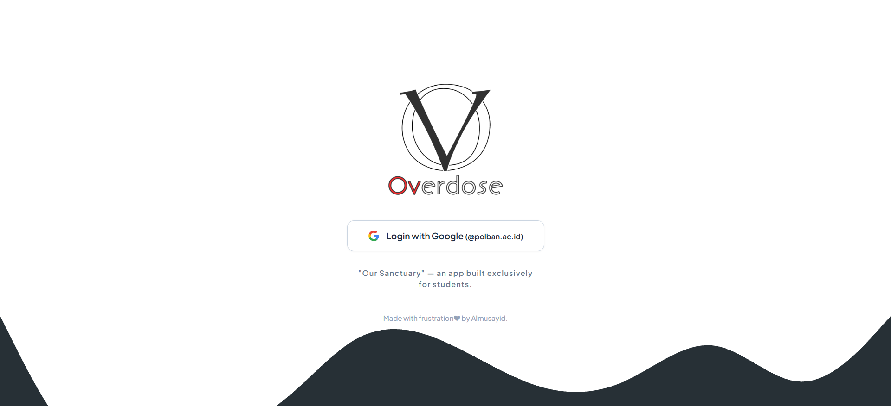
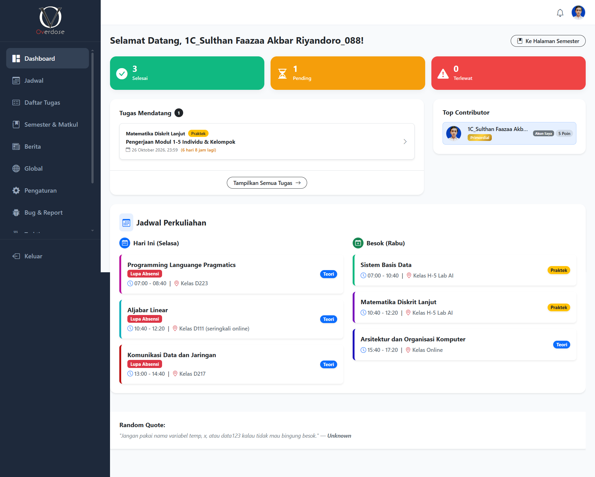
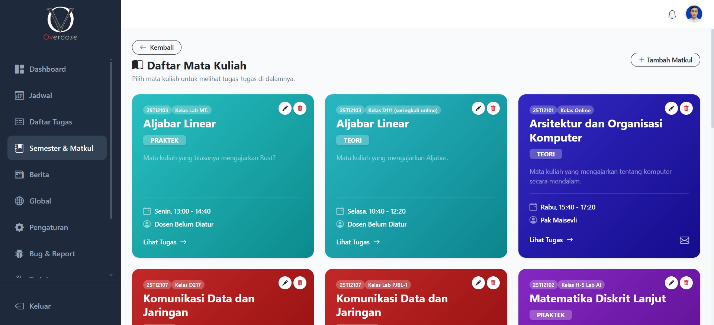
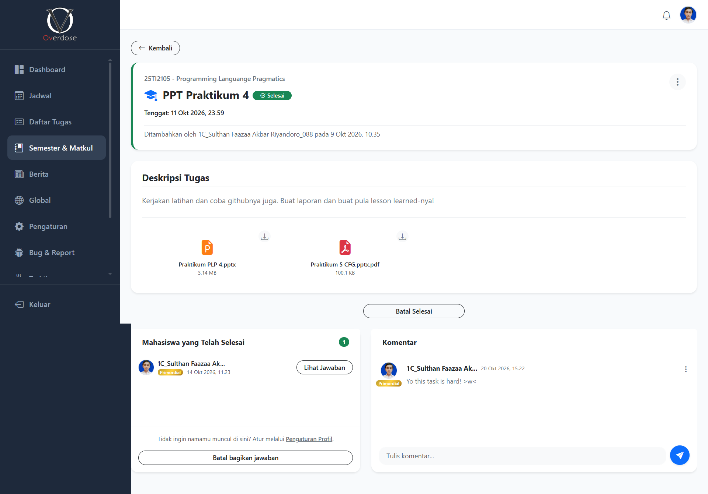
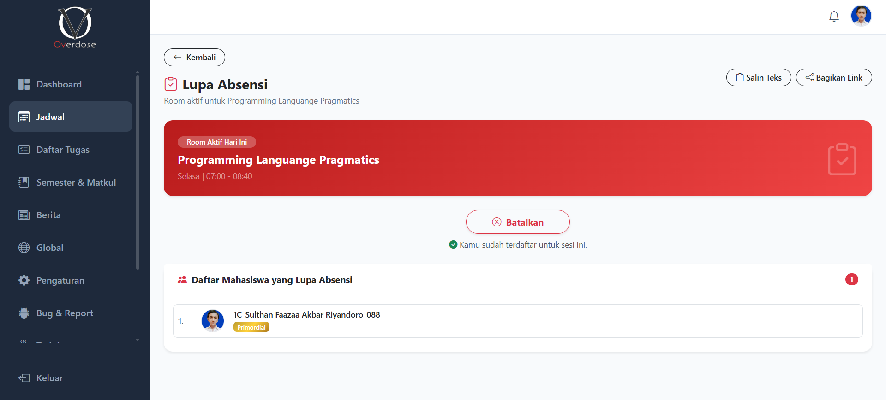
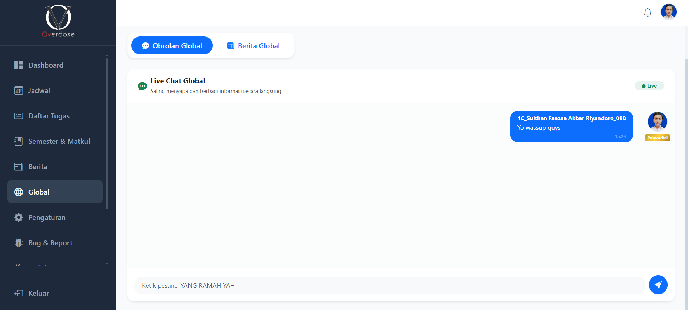
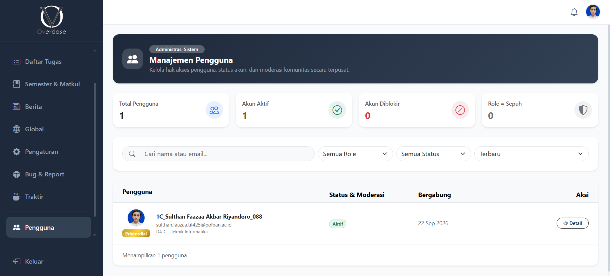
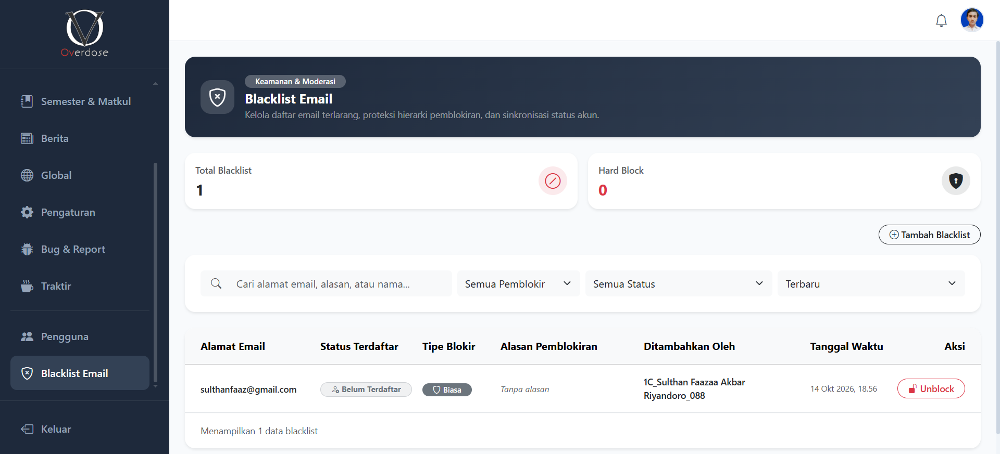
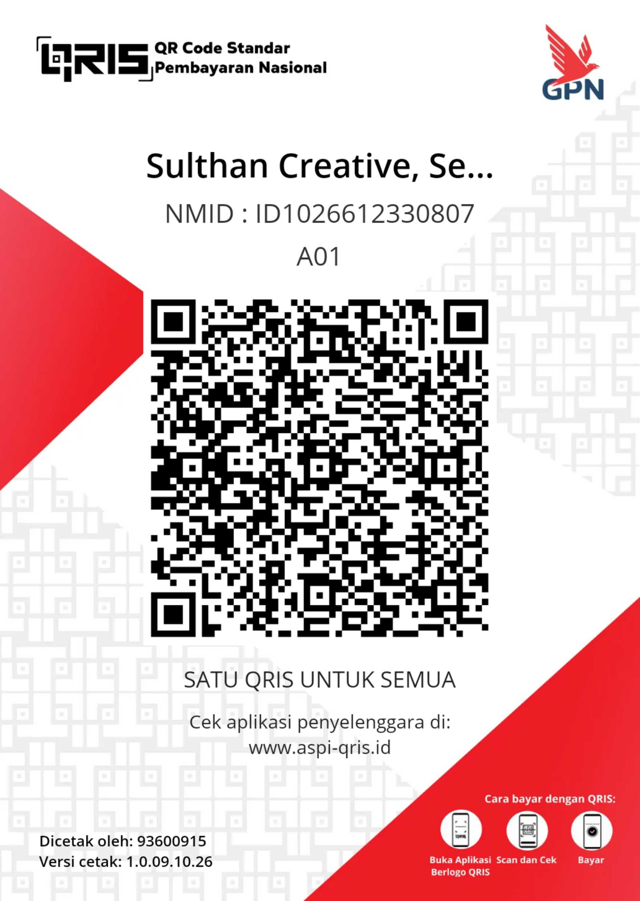

<p align="center">
  
</p>

<p align="center">
  <strong>Our Sanctuary &mdash; An Academic Collaboration & Task Orchestration Ecosystem</strong>
</p>

<p align="center">
  
  
  
  
  
  
  
  
  
</p>

---

## Executive Overview

**Overdose** is a comprehensive, campus-exclusive web application engineered to solve one of the most persistent hurdles in modern collegiate life: **academic fragmentation and deadline chaos**.

In typical university environments, crucial course materials, assignment briefs, peer solutions, and announcements are scattered across chaotic messaging groups, unorganized cloud folders, and verbal classroom notices. **Overdose** acts as a unified digital sanctuary &mdash; an intuitive, high-performance platform where students collaborate, share solutions, coordinate coursework, track deadlines in real time, and manage attendance reconciliation with zero friction.

Engineered with a lightweight, clean **MVC architecture in modern PHP**, an asynchronous **modular ES6+ frontend**, and zero bloated compilation pipelines, Overdose delivers an ultra-responsive, Single Page Application (SPA)-like experience that deploys seamlessly on standard enterprise or shared server environments.

---

## Live Demo & Public Preview Access

To allow prospective clients, recruiters, and collaborators to experience Overdose firsthand, a dedicated public demo credential has been designated:

* **Demo Account ID**: `overdose.demo@gmail.com`
* **Access Mode**: Public Preview / Sandbox Observer

> [!NOTE]
> **Planned Architecture Update (Dedicated Read-Only Demo Tier):**
> A dedicated, singular `Demo` user role is scheduled for an upcoming major release. This specialized role will provide open access for visitors using `overdose.demo@gmail.com` to freely inspect every section of the platform interface (Dashboard, Courses, Tasks, Attendance, Community Hub) in a strict **Read-Only Sandbox Mode**, ensuring zero unintended modifications to live academic data while offering an unrestricted walkthrough.

---

## Key Real-World Features & Business Value

```
+---------------------------------------------------------------------------------------+
|                                    OVERDOSE SYSTEM                                    |
|                                "Our Academic Sanctuary"                               |
+---------------------------------------------------------------------------------------+
|                                                                                       |
|  [ Academic Core ]           [ Collaboration Hub ]       [ Campus Security & Moderation ] |
|  - Semester Hierarchy        - Peer Answer Sharing       - 3-Tier Role Governance     |
|  - Course Directories        - File Attachments (Drive)  - Dual-Tier Email Blacklist  |
|  - Real-Time Schedules       - Contextual Discussions    - Real-Time Session Sentry   |
|  - Forgotten Attendance      - Deadline Intelligence     - User Activity Audit Logs   |
|                                                                                       |
|  [ News & Global Feeds ]     [ Personalization ]         [ Built-In Issue Triage ]    |
|  - Class News Feed           - Dark & Light Themes       - Bug Report Management      |
|  - Global Campus Bulletin    - Privacy & Anonymous Mode  - Role-Based Anti-Spam Gate  |
|  - Real-Time Live Chat       - Web Push Notifications    - Direct Status Lifecycle    |
|                                                                                       |
+---------------------------------------------------------------------------------------+
```

### 1. Unified Dashboard & Deadline Intelligence
* **At-a-Glance Academic Metrics**: Real-time counters categorizing tasks into *Completed*, *Pending*, and *Overdue*.
* **Urgency-Sorted Task Feed**: Prioritizes urgent assignments with live deadline countdowns, enabling students to plan study schedules proactively.
* **Curated Daily Inspo**: Multilingual motivational quotes and software engineering pro-tips that keep students focused and engaged.

### 2. Peer-to-Peer Task & Solution Sharing Center
* **Collaborative Answer Repository**: Students can upload their own reports, code files, and references to assist classmates who need study guidance.
* **Granular Completion Tracking**: Students can mark tasks as finished with instant visual feedback.
* **Privacy-First Anonymous Mode**: Students who prefer discretion can toggle anonymous completion mode, preserving their privacy while maintaining accountability.
* **Threaded Task Comments**: On-topic discussion channels nested under each assignment for troubleshooting and peer review.
* *(Note: Automated AI assistant integration is temporarily suspended pending backend model updates).*

### 3. Forgotten Attendance Room (*"Lupa Absensi"*)
* **The Real-World Dilemma**: Students frequently miss class attendance rosters due to lab work, device issues, or late arrival.
* **The Overdose Solution**: Provides an on-demand virtual attendance room tied to the active lecture schedule.
* **One-Click WhatsApp Clipboard Export**: Generates a standardized, formatted text roster of students who missed attendance with a single click &mdash; ready to forward immediately to lecturers or class leaders.

### 4. Digital Course & Learning Material Repository
* **Multi-Semester Catalog**: Organized navigation tree: *Semester &rarr; Course (Teori vs. Praktek) &rarr; Materials & Assignments*.
* **Lecturer Contact Cards**: Quick access to lecturer names, official academic emails, and direct WhatsApp contact channels.
* **Cloud Document Integration**: Direct integration with Google Drive API and localized storage for seamless previewing and downloading of lecture slides and jobsheets.

### 5. Campus News & Global Community Live Chat
* **Dual-Channel Bulletin**:
  * **Class News**: Internal class announcements with lazy-loaded thumbnails and high-res lightbox previews.
  * **Global News**: Campus-wide broadcasts, academic events, and general updates.
* **Global Live Chat**: Real-time peer-to-peer discussion room with thread replies, message editing, and community communication.

### 6. Integrated Bug & Issue Ticketing
* **Built-In Problem Reporting**: Users can report bugs, UI glitches, or feature suggestions directly within the application.
* **Direct Lifecycle Triage**: Simple two-state moderation (*Diproses* &harr; *Selesai*) prioritized by urgency.
* **Role-Based Anti-Spam Throttling**: Prevents reporting floods through tiered rate-limiting (Primordial: unrestricted, Sepuh: 60s cooldown, Keroco: 1h cooldown with live countdown timer).

---

## 3-Tier Enterprise Governance & Security

Overdose implements a strict, tamper-resistant authorization model designed to prevent unauthorized administrative escalation and protect student privacy:

| Role Level | Badge Styling | Core Privileges & Responsibilities |
| :--- | :--- | :--- |
| **Primordial** | **Gold Gradient** | **System Owner / Superadmin**. Absolute administrative rights. Immune to blocks. Can assign or demote roles, enforce permanent *Hard Blocks*, manage system settings, and inspect system audit trails. |
| **Sepuh** | **Silver / Dark Badge** | **Class Admin / Moderator**. Can manage structural academic entities (courses, schedules, materials), view detailed user activity logs, and blacklist suspicious accounts with mandatory audit justifications. |
| **Keroco** | **Clean Light Badge** | **Student / Active Member**. Full collaborative access to assignments, shared answers, discussions, attendance rooms, and global community feeds. |
| **Demo** *(Roadmap)* | **Blue Outline Badge** | **Public Observer / Read-Only Guest**. Singled-user account (`overdose.demo@gmail.com`) engineered for public inspection. Once deployed in a future release, will provide safe, read-only system browsing without modification privileges. |

### Advanced Security Safeguards
* **Institutional Domain Restriction**: Authentication strictly accepts `@polban.ac.id` accounts via Google OAuth 2.0. Non-campus domains are immediately rejected.
* **Dual-Tier Blacklist & Lock Mechanism**:
  * *Regular Block*: Standard moderation lock that Sepuh moderators can apply and revoke.
  * *Hard Block*: High-security, permanent lockout applied exclusively by Primordial that lower-tier admins cannot circumvent.
* **Zero-Trust Active Session Destruction**: Middleware (*Gatekeeper*) checks user authorization on every incoming request. If an account is blocked or blacklisted while logged in, their session is destroyed immediately.
* **SQL Injection & Prepared Statement Hardening**: Complete elimination of multi-parameter reuse issues with native PDO prepared statements.

---

## Visual Showcase (Screenshots Gallery)

### 1. Campus Login & Secure OAuth Portal
<p align="center">
  
  <br>
  <em>Minimalist, campus-branded login portal with Google Workspace authentication.</em>
</p>

---

### 2. Central Academic Dashboard
<p align="center">
  
  <br>
  <em>Displays urgent tasks, metric counters, semester filter, and curated daily pro-tips.</em>
</p>

---

### 3. Semester & Course Navigator
<p align="center">
  
  <br>
  <em>Color-coded academic directory, lecture timetable, and lecturer contact channels.</em>
</p>

---

### 4. Assignment Center, Shared Answers & Discussion
<p align="center">
  
  <br>
  <em>Structured assignment briefs, peer shared answers, downloadable files, and threaded discussion.</em>
</p>

---

### 5. Forgotten Attendance Room ("Lupa Absensi")
<p align="center">
  
  <br>
  <em>Live attendance room with one-click standardized clipboard export for lecturers.</em>
</p>

---

### 6. Global Live Community Chat & Bulletin
<p align="center">
  
  <br>
  <em>Real-time community chat with thread replies, message editing, and campus announcements.</em>
</p>

---

### 7. User Management & Activity Audit Trail
<p align="center">
  
  <br>
  <em>Student directory administration, centered role badges, and activity history tracking.</em>
</p>

---

### 8. Security & Email Blacklist Management
<p align="center">
  
  <br>
  <em>Dual-tier email moderation console with automated account synchronization.</em>
</p>

---

## Technical Architecture & Design Decisions

```
c:\xampp\htdocs\_Projects_\P020-Overdose\
├── app/
│   ├── api/                   # RESTful JSON API endpoints
│   │   ├── auth/              # OAuth 2.0 redirect, callback & session gatekeeper
│   │   ├── user_management.php# Account governance & role modification
│   │   ├── user_activities.php# Activity history audit trail
│   │   ├── tasks.php          # Assignment CRUD & completion logic
│   │   ├── bug_reports.php    # Issue ticketing & anti-spam rate limiter
│   │   └── blacklist.php      # Email moderation & security lockouts
│   ├── config/                # Database PDO singleton & global environment
│   └── views/                 # Modular presentation templates (HTML/PHP)
│       ├── layout.php         # Master responsive wrapper, sidebar & toasts
│       ├── dashboard.php      # Academic overview & metric counters
│       ├── task_detail.php    # Task breakdown & peer answer hub
│       └── blacklist.php      # Security console
├── database/
│   └── scheme/                # Relational DDL & schema migrations
├── public/
│   ├── assets/
│   │   ├── css/               # Core design system & theme tokens
│   │   └── img/               # Logos, badges, and QRIS donation assets
│   └── js/
│       └── modules/           # Native ES6+ modular client scripts
├── index.php                  # Front Controller & clean URL routing
└── README.md                  # Project documentation
```

### Architectural Highlights
1. **Zero-Build Overhead**: Built without heavy node build pipelines (Webpack, Vite, or Tailwind compilers). The app runs directly in any production PHP/Apache environment with instant reload and zero compile lag.
2. **SPA-Like UX with Vanilla JavaScript**: Uses native ES6+ modules and the Fetch API to load tables, pagination, and forms asynchronously without jarring full-page refreshes.
3. **Smart Downscaling & Lazy Loading**: Media items and news banners use lazy-loading and downscaled thumbnails, keeping bandwidth footprint minimal on mobile networks.
4. **Hard-Scroll Anchor Pagination**: Custom pagination that instantly hard-jumps the viewport directly to the active control and cleans the URL hash automatically within 150ms.

---

### Installation Steps

((DEPLOYMENT IS IN PROGRESS...))

---

## Support the Developer ("Traktir Developer")

If Overdose brings value to your academic journey or inspires your software architecture, consider supporting ongoing server hosting costs:

<p align="center">
  
  <br>
  <em>Scan via any Indonesian Bank or e-Wallet (GoPay, OVO, Dana, ShopeePay, BCA, etc.)</em>
</p>

---

## License

This project is licensed under the **GNU General Public License v3.0 (GPLv3)**. See the [LICENSE](LICENSE) file for more details.

---

<p align="center">
  Crafted with care, passion, and precision for the academic community.<br>
  <strong>&copy; Overdose &mdash; Our Sanctuary. All rights reserved.</strong>
</p>
